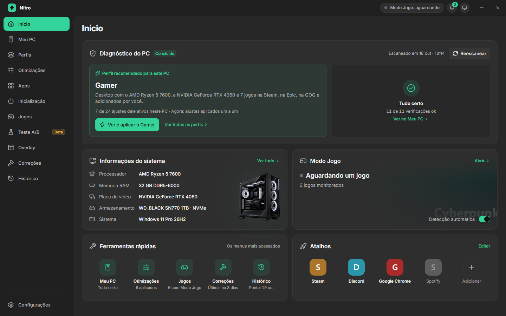
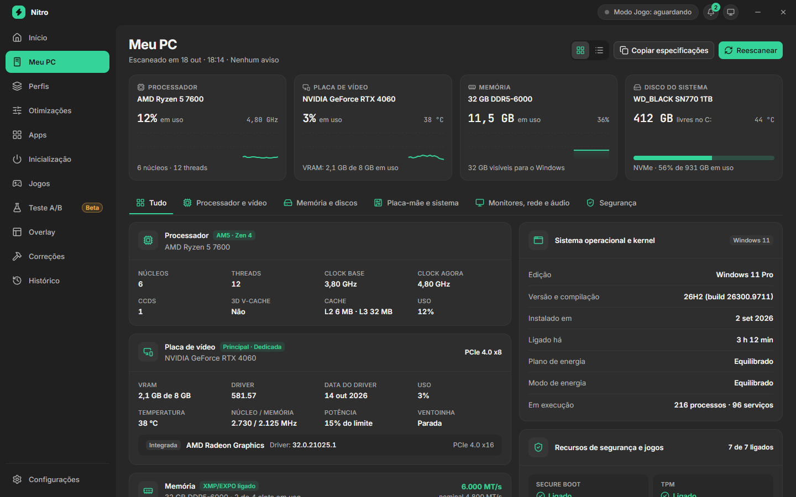
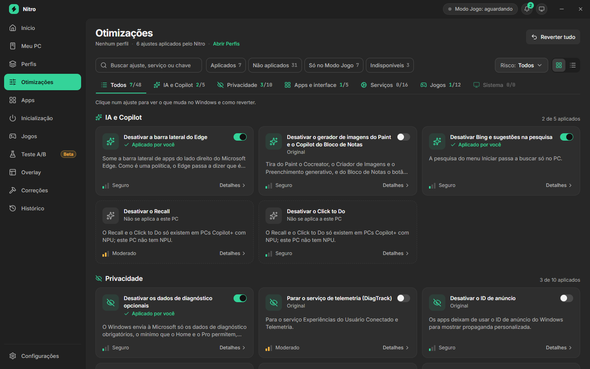
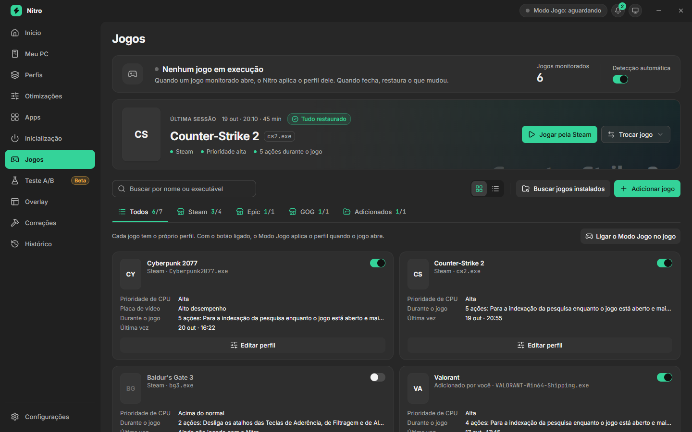
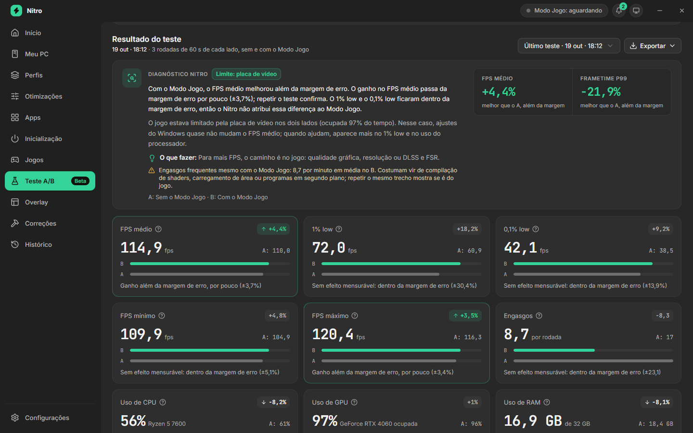
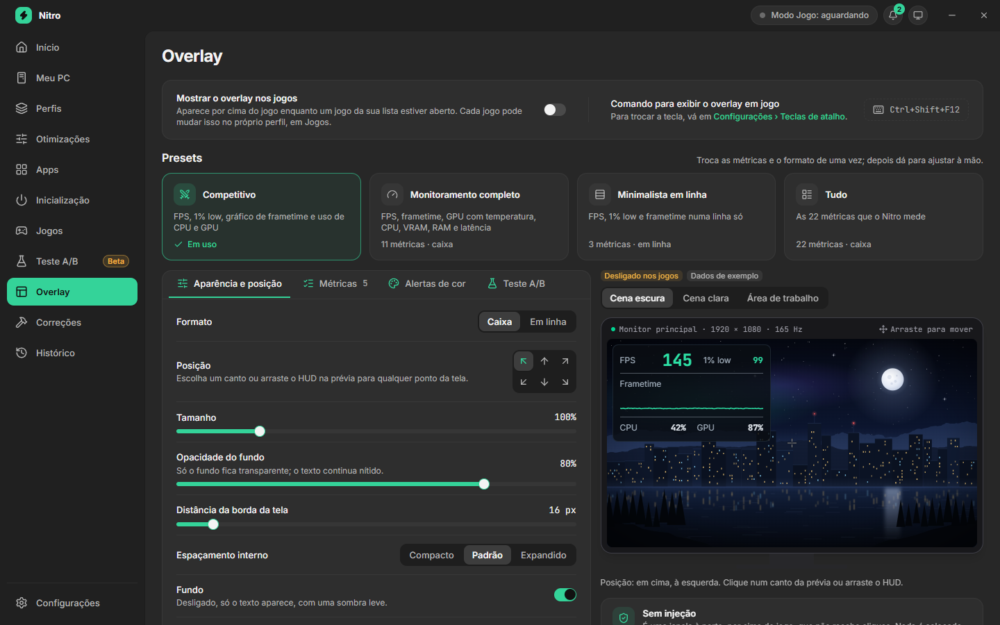
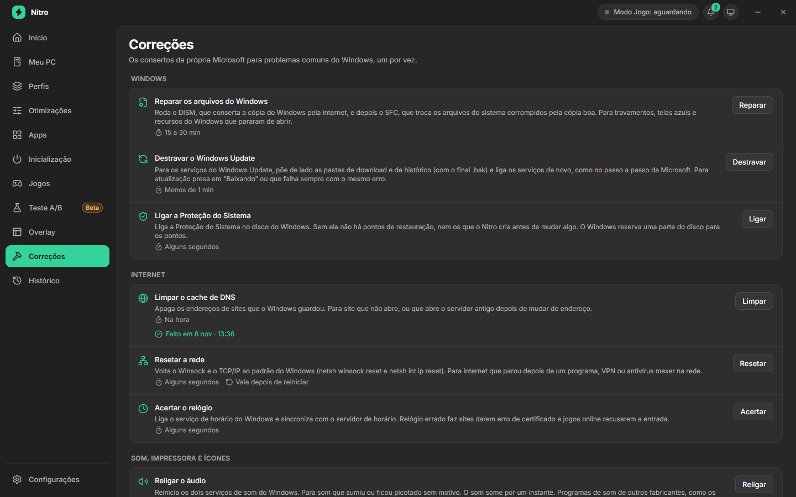
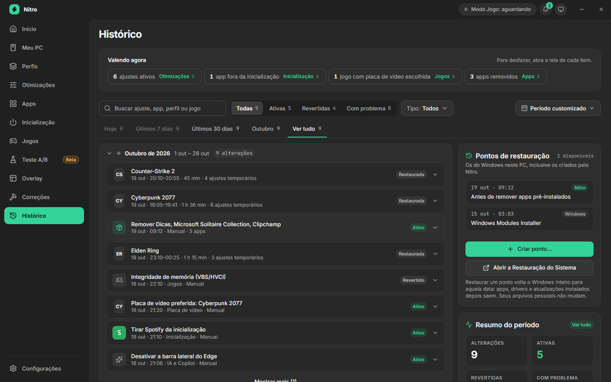

# Nitro

Otimizador do Windows 11 para jogos. Antes de mudar qualquer coisa, o Nitro mostra o que muda no Windows. Cada mudança fica no histórico e pode ser desfeita.

**[Baixar a versão mais recente](https://github.com/Diiipereira/nitro-releases/releases/latest)** · Windows 11 64 bits

> [!NOTE]
> O Nitro está em beta. A tela Teste A/B ainda está em desenvolvimento, e os números dela podem ser imprecisos.

## O que o Nitro faz

### Meu PC

Mostra o processador, a placa de vídeo, a memória, os discos, os monitores, a rede e o áudio, com o uso de cada um ao vivo. Também confere o que costuma tirar desempenho dos jogos e diz como resolver:

- monitor rodando abaixo da taxa máxima ou ligado na placa de vídeo errada;
- memória sem o XMP/EXPO ou em um canal só;
- placa de vídeo com o driver antigo ou com a conexão PCIe abaixo do máximo;
- pouco espaço no disco dos jogos;
- conexão de rede lenta, como um Wi-Fi fraco;
- entre outros.

### Otimizações e Perfis

Ajustes do Windows separados por assunto: IA e Copilot, privacidade, apps e interface, serviços, jogos e sistema. Cada ajuste diz o que muda, o nível de risco e se precisa reiniciar, e cada um liga e desliga à parte. Os perfis prontos (Conservador, Equilibrado e Gamer) aplicam vários ajustes de uma vez. Também dá para criar o seu próprio perfil.

### Apps e Inicialização

- **Apps:** remove apps que vêm instalados com o Windows, com a prévia do que sai, e reinstala se você mudar de ideia.
- **Inicialização:** mede quanto cada programa pesa quando você entra no Windows. Dá para tirar da inicialização o que não precisa abrir junto.

### Modo Jogo

O Nitro encontra os jogos da Steam, da Epic e da GOG, e você pode adicionar outros pelo executável. Cada jogo tem um perfil próprio: prioridade do processador, placa de vídeo preferida, programas para fechar e ajustes que valem só enquanto o jogo está aberto. Quando o jogo abre, o Nitro aplica o perfil. Quando o jogo fecha, desfaz tudo.

O Modo Jogo nunca mexe em anti-cheats (EasyAntiCheat, BattlEye, Vanguard e outros), no launcher do jogo, em drivers, no shell do Windows nem no próprio Nitro.

### Teste A/B (beta)

Mede o mesmo trecho de um jogo em rodadas alternadas, sem o Nitro (A) e com o Nitro (B), e compara os dois lados:

- FPS médio, 1% low, 0,1% low, FPS mínimo e máximo;
- engasgos, tempo de cada quadro e uso de processador, placa de vídeo e memória.

Cada diferença vem com a margem de erro, para separar um ganho de verdade de uma variação normal. O resultado sai em PDF, em planilha (CSV) ou em JSON.

### Overlay

Mostra o FPS, o 1% low, o gráfico do tempo de cada quadro e o uso do processador e da placa de vídeo por cima do jogo. Os presets prontos podem ser ajustados à mão. O overlay é uma janela à parte, por cima do jogo: o Nitro não injeta nada no jogo.

### Correções

Os consertos da própria Microsoft para problemas comuns do Windows, um clique cada:

- reparar os arquivos do Windows (DISM e SFC);
- destravar o Windows Update;
- limpar o cache de DNS;
- resetar a rede;
- acertar o relógio;
- religar o áudio, entre outros.

### Histórico

Tudo o que o Nitro mudou, com o que continua valendo agora e o botão para desfazer cada item. A mesma tela mostra os pontos de restauração do Windows e cria um novo quando você quiser.

## Tudo pode ser desfeito

- Cada ajuste mostra o que muda e como voltar antes de você aplicar.
- **Reverter tudo**, em Otimizações, volta os ajustes, os programas tirados da inicialização, a placa de vídeo escolhida por jogo e os apps removidos.
- Antes de aplicar um perfil ou remover apps, o Nitro pode criar um ponto de restauração do Windows. Em Configurações, você escolhe se ele cria sozinho ou só quando você marcar.
- Ao desinstalar, o Nitro pergunta se você quer voltar tudo o que ele mudou.
- O Nitro nunca desativa o Windows Defender, o Firewall, o UAC nem o SmartScreen, e nunca desliga o Windows Update de vez.

## Requisitos

- Windows 11, 64 bits.
- Permissão de administrador. Muitos ajustes valem para o Windows inteiro, então o Nitro pede essa permissão ao abrir. Quando ele abre junto com o Windows, não pergunta de novo a cada vez.

## Como instalar

1. Em [Releases](https://github.com/Diiipereira/nitro-releases/releases/latest), baixe o arquivo `Nitro_<versão>_x64-setup.exe`.
2. Abra o arquivo. O instalador ainda não tem assinatura de código, então o Windows pode mostrar o aviso "O Windows protegeu o computador". Nesse caso, clique em **Mais informações** e depois em **Executar assim mesmo**.
3. Siga o instalador. Se faltar o WebView2 da Microsoft, que o Nitro usa para mostrar as telas, o instalador baixa e instala.

## Atualizações

O Nitro procura uma versão nova ao abrir e a cada 6 horas.

- **Com a janela fechada** (Nitro na bandeja): ele instala sozinho, mas nunca durante uma sessão do Modo Jogo ou um Teste A/B.
- **Com a janela aberta:** a versão nova aparece em Configurações › Atualizações, com as notas da versão e o botão **Instalar agora**.

Cada atualização é conferida por uma assinatura digital antes de instalar. Um arquivo alterado é recusado.

## Privacidade

O Nitro não envia nenhum dado. Ele só usa a internet para procurar atualizações, e isso só baixa um arquivo deste repositório, sem mandar nada sobre o seu PC. Os dados do Nitro ficam no seu PC, em `%APPDATA%\Nitro`.

## Desinstalar

Em Configurações do Windows › Aplicativos › Aplicativos instalados, procure o Nitro e clique em **Desinstalar**. O desinstalador pergunta se você quer voltar tudo o que o Nitro mudou.

---

Este repositório guarda os instaladores de cada versão e o arquivo que o Nitro lê para se atualizar. As imagens usam dados de exemplo.
